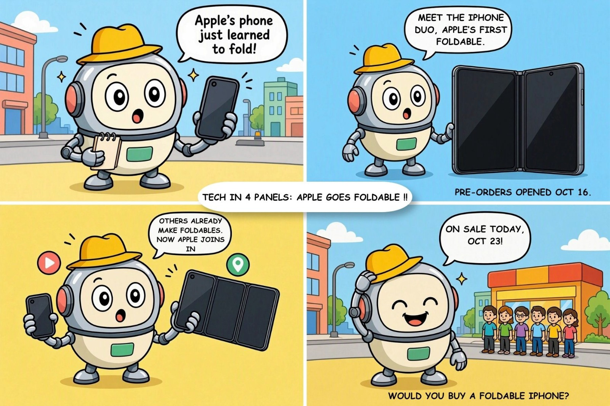

# NewsLens

**A short daily news briefing ranked by importance, not clicks.**

NewsLens gives a short daily list of the most important stories from Times of India, picked by machine learning. When a story is hard to understand, a button shows it as a simple 4-panel comic.

## The Problem

- Fewer people read newspapers now.
- News apps rank stories by clicks, so gossip can appear above a health alert.
- Endless feeds mean nobody feels "done" with the news.
- Feeds only show what you already like (filter bubble).

People spend hours on news but still miss what matters.

## Our Solution

- **Must Know Today:** the 5 to 10 most important stories
- **Sections:** India, Business, World, Sports
- **Short summaries** with a link to the full Times of India article
- **"You're all caught up"** screen at the end
- **Comic version (PanelPulse):** tap a button to see a hard story as 3 to 4 simple comic panels
- No ads, no click tracking, the same list for everyone

## How It Works

1. **Collect:** headlines come from Times of India RSS feeds
2. **Label:** the team marks headlines as important (policy, health, money, safety, education) or not important (gossip, clickbait, trivia)
3. **Train:** TF-IDF with Logistic Regression learns from the labels and ranks new stories
4. **Check:** accuracy and F1-score
5. **Show:** the backend sends ranked stories to the app
6. **Comic (optional):** a language model turns the headline and summary into comic panels

## PanelPulse (Comic Feature)

A manual test is complete: one news story became a finished 4-panel comic with a consistent robot reporter mascot.

Rules for comics: use only the headline and short summary, add text in code (not inside generated images), avoid real people's faces, label every comic "AI-assisted", and credit the source.

## Tech Stack

| Part | Tool |
|---|---|
| News source | Times of India RSS feeds |
| Fetching | Python, feedparser |
| Machine learning | scikit-learn, sentence-transformers |
| Backend | FastAPI |
| Database | SQLite |
| Updates | APScheduler (every 30 minutes) |
| Frontend | React with Tailwind CSS |
| Hosting | Render or Railway, Vercel or Netlify |

## Repository Structure

- `backend/`: API, feed fetching, database
- `ml/`: labeled data and model training
- `frontend/`: the app
- `generator/`: PanelPulse comic generator
- `docs/`: tests and notes
- `images/`: screenshots and sample comics

## Status

- [x] Idea and plan
- [x] Comic concept tested manually
- [ ] Feed fetching
- [ ] Labeled dataset
- [ ] Importance model
- [ ] Backend API
- [ ] Frontend app
- [ ] Automated comic generation
- [ ] Pilot survey and user testing

## Limitations

- "Important" is partly an opinion.
- Only one newspaper for now.
- Feeds give only headlines and short summaries, so comics are simple explanations, not the full story.
- Small data, so some stories may be sorted wrongly.

## Future Scope

More newspapers, Kannada and Hindi, better AI comic art, an email digest, and a mobile app.

## Sustainable Development Goals

SDG 9, SDG 11, SDG 17

## Credits

News headlines, short summaries and links belong to Times of India. NewsLens shows only short summaries with credit and a link to the original article.
